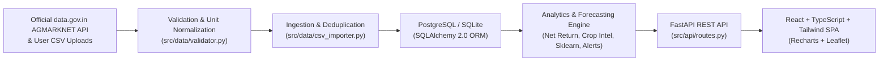

# Architecture Documentation — CropLedger

## System Architecture

## Database Schema Relationships

- `commodities` (1) ──< `daily_prices` (N) >── (1) `markets`
- `commodities` (1) ──< `arrivals` (N) >── (1) `markets`
- `commodities` (1) ──< `user_watchlist` (N) >── (0..1) `markets`
- `commodities` (1) ──< `price_alerts` (N) >── (0..1) `markets`
- `price_alerts` (1) ──< `alert_events` (N)
- `data_refresh_logs` (1) ──< `validation_issues` (N)
- `commodities` (1) ──< `forecast_results` (N) >── (1) `markets`
- `user_preferences` stores local workspace defaults (`preferred_state`, transport/commission assumptions).

Full PostgreSQL DDL is available in [schema.sql](file:///D:/90%20days/90-days-90-projects-day-19-cropledger/sql/schema.sql).

## Core API Endpoints

| Method | Endpoint | Purpose |
| :--- | :--- | :--- |
| `GET` | `/api/health` | Database connectivity and dataset mode check |
| `GET` | `/api/meta/filters` | Dynamic commodities, varieties, states, districts, markets, dates |
| `GET` | `/api/overview` | Market summary, daily briefing, followed crops, price trend |
| `POST` | `/api/price-advisor/calculate` | Net-return market ranking & dynamic explanation |
| `GET` | `/api/atlas/markets` & `/api/atlas/summary` | Verified coordinate markers, unmapped list, national spread |
| `GET` | `/api/crops/{commodity_name}` | Historical aggregations, seasonality, volatility, arrival correlation |
| `GET` | `/api/market-comparison` | Side-by-side comparison for up to 4 markets |
| `GET` | `/api/reports` & `/api/reports/export` | Paginated, sortable register + CSV/PDF export |
| `GET` | `/api/forecast` | Chronological 7-day forecast + holdout MAE/RMSE + observations |
| `GET/POST/DELETE` | `/api/watchlist`, `/api/alerts` | Watchlist management and threshold/movement alerts |
| `GET/POST/DELETE` | `/api/data-quality`, `/api/data/import`, `/api/data/refresh` | Validation audit, CSV upload, AGMARKNET sync |
| `GET/PUT` | `/api/settings` | User workspace defaults persistence |
